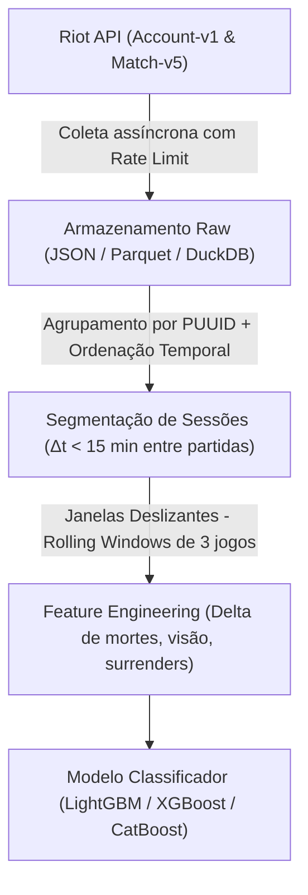
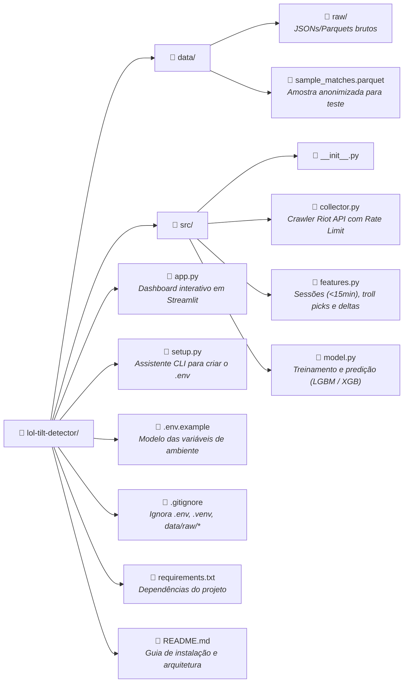

# lol-tilt-detector
A detector for when you're tilted, to remind you to stop and smell the flowers.
Um detector para quando você está tiltado, para te lembrar de fazer uma pausa e sentir o cheiro das flores.

Este projeto prevê a probabilidade de o jogador de League of Legends estar 'tiltado', isto é, extremamente frustrado e irritado após uma sequência de jogos ruins, sugerindo uma pausa com uma interface agradável e calma.

O modelo funciona com base em engenharia de atributos temporais e conecta-se com a Riot Games Developer Portal.

> Este projeto não é endossado pela Riot Games e não reflete as visões ou opiniões da Riot Games ou de qualquer pessoa oficialmente envolvida na produção ou gerenciamento de propriedades da Riot Games.

## Como usar
- Demo Mode: teste com dados de exemplo
- Analisar minha conta: insira sua API Key da Riot Games e teste com sua própria conta.

## Arquitetura do pipeline

**Coleta de dados vida Riot API**: conexão via dois roteamentos regionais. Account-v1 (americas): Converte GameName#TagLine em PUUID. Match-v5 (americas): Busca a lista de matchIds (type=ranked para evitar ruído de modos for-fun como ARAM) e os detalhes de cada partida.

**Campos críticos do JSON da Match-v5**: são coletados atributos temporais, de resultado e rendição e indicadores de tilt.

**Segmentação de sessão**: segue uma fórmula baseada na variável ´gameCreation´ em que:

$$\Delta t = \text{gameCreation}_t - \text{gameEndTimestamp}_{t-1}$$

Isto é, partidas com menos de 15 minutos de intervalo de descanso são classificadas como pertencentes à mesma sessão. O modelo é acionado após *4 partidas consecutivas*.

## Variáveis utilizadas na engenharia de atributos temporais

- **Momentum / Fadiga**
    - Feature: loss_streak_session
        - Número de derrotas seguidas nas últimas 3 partidas (0 a 3).
    - Feature: avg_rest_time_sec
        - Média de $\Delta t$ entre as partidas, a partir do clique em 'Jogar novamente'.
    - Feature: session_duration_min
        - Tempo total acumulado jogando na sessão antes da partida $t$.
- **Tendência de morte**
    - Feature: deaths_per_min_slope
        - Inclinação (regressão linear simples) de deaths / min de $t-3$ até $t-1$. Se a taxa de mortes está subindo jogo a jogo, o jogador está jogando de forma cada vez mais imprudente.
- **Tendência de visão**
    - Feature: pink_wards_delta
        - $(\text{Pinks}_{t-1} - \text{Pinks}_{t-3})$ ou razão contra a média histórica do jogador. Jogadores tiltados param de gastar ouro com controle de mapa e focam apenas em itens de dano.
- **Frustração e uso do chat**
    - Feature: spam_pings_ratio
        - Razão de pings de alerta/desaparecido na última partida ($t-1$) vs média do jogador. Jogadores tiltados usam spam de pings para conflitos com a equipe e para expressar frustração, porque é mais rápido do que digitar no chat.
- **Colapso/rendição rápida**
    - Feature: had_surrender_prev
        - Flag binária se a partida $t-1$ acabou em rendição (gameEndedInSurrender). Sair de um jogo que terminou em rendição carrega a frustração para a próxima partida. 
- **Champion swap**
    - Feature: champion_switch_rate
        - Quantos campeões diferentes jogou nas últimas 3 partidas (1 a 3). Trocar muito de campeão após derrotas pode ser uma forma de tilt pick
- **Trol pick**
    - Feature mais complexa, detalhada abaixo:

Calcula-se a popularidade de campeão numa rota:

$$P(\text{Role} \mid \text{Champion}) = \frac{\text{Partidas do Campeão naquela Rota}}{\text{Total de Partidas do Campeão na Base}}$$

Exemplo: Se a Lulu aparece em 94% das vezes como UTILITY (Suporte), 4% no MIDDLE e 0,05% na JUNGLE, qualquer partida dela como JUNGLE recebe uma pontuação próxima de zero.

Diferenciamos um jogador que usa um personagem incomum pela maestria com o campeão, por meio do histórico coletado (player_champ_games).

O sinal real de tilt vem da combinação de is_off_meta_pick == 1 E player_champ_games == 0 (primeira vez jogando com um boneco totalmente fora de posição logo após uma derrota).

Essa análise é complementada pela autofill_or_role_tilt comparada com a rota geralmente jogada pelo jogador em primary_role. Se o jogador é Main ADC (BOTTOM em 80% dos jogos), cai na JUNGLE e escolhe um campeão sem sinergia com a selva, a probabilidade de colapso emocional na partida dispara.

## Estrutura do repositório
